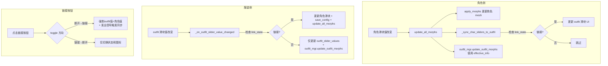

# Outfit 滑块链接/断开功能 — 实现计划

## 概述

在 `Outfit Default Sliders` 和 `Outfit Custom Sliders` 面板中，当 outfit 滑块与 `Default Sliders` / `Custom Sliders` 中存在对应滑块（`char_slider_id` 不为 `None`）时，在其名称左侧添加一个链接切换按钮。

### 两种状态

| 状态 | 按钮符号 | 行为 |
|------|----------|------|
| **链接** (默认) | 🔗 | 双向同步：修改任一侧滑块，另一侧跟随变动 |
| **断开** | ⛓️‍💥 | 独立调整：两侧数值互不影响 |

切换规则：**断开 → 链接** 时，outfit 滑块数值强制变为其对应角色滑块的当前值。

---

## 现有数据流分析

```
角色滑块变化
  → update_all_morphs()
    → apply_morphs(original_points, morph_data, sliders_info)     # 更新角色 mesh
    → outfit_mgr.update_outfit_morphs()                             # 更新 outfit mesh（用 sliders_info）
    → _sync_char_sliders_to_outfit()                                # 推送值到 outfit 滑块 UI

服装滑块变化
  → outfitSliderValueChanged 信号
    → _on_outfit_slider_value_changed()
      → 更新 sliders_info[char_slider_id]["current_value"]
      → 更新角色滑块 UI widgets
      → save_config()
      → update_all_morphs()
```

### 需要改变的关键点

1. **角色→服装单向同步** (`_sync_char_sliders_to_outfit`)：需要**跳过断开的滑块**
2. **服装→角色单向同步** (`_on_outfit_slider_value_changed`)：断开时**只更新 outfit mesh**，不更新角色数据
3. **Outfit mesh 计算** (`update_outfit_morphs`)：断开时需要用 **outfit 独立值**覆盖 `sliders_info` 中的角色值

---

## 新增状态存储 (在 `BodySlider` 应用层)

```python
# 链接状态: outfit_key → bool (True=链接, False=断开)
self.outfit_link_states: Dict[str, bool] = {}

# outfit 滑块独立数值: outfit_key → float
self.outfit_slider_values: Dict[str, float] = {}

# outfit_key → char_slider_id 映射（用于 morph 计算时快速查找）
self.outfit_slider_mapping: Dict[str, Optional[str]] = {}
```

---

## 修改文件清单 (7个文件)

### 1. [`language/en.json`](language/en.json:244) / [`language/zh.json`](language/zh.json:273) / `language/ko.json`

新增两个 tooltip 翻译键：

| 键 | 英文 | 简体中文 |
|----|------|----------|
| `tooltip_outfit_link_linked` | `"Click to unlink — value synced with character slider"` | `"点击断开 — 当前数值与角色滑块同步"` |
| `tooltip_outfit_link_unlinked` | `"Click to link — value will sync to character slider value"` | `"点击链接 — 数值将与角色滑块同步"` |

---

### 2. [`core/ui_constants.py`](core/ui_constants.py:499)

新增链接切换按钮样式常量：

```python
LINK_TOGGLE_BUTTON_STYLE = f"""
    QPushButton {{
        background: transparent;
        border: 1px solid {COLOR_BORDER};
        border-radius: 4px;
        color: {COLOR_TEXT_BRIGHT};
        font-size: 14px;
        padding: 2px 4px;
        min-width: 28px;
        max-width: 28px;
        min-height: 24px;
        max-height: 24px;
    }}
    QPushButton:hover {{
        background-color: {COLOR_BG_HOVER};
        border-color: {COLOR_ACCENT};
    }}
"""
```

---

### 3. [`core/outfit_manager.py`](core/outfit_manager.py:167)

#### 3a. [`OutfitHost`](core/outfit_manager.py:22) — 新增属性

```python
@property
def outfit_link_states(self) -> Dict[str, bool]:
    return getattr(self._app, "outfit_link_states", {})

@outfit_link_states.setter
def outfit_link_states(self, v: Dict[str, bool]):
    self._app.outfit_link_states = v

@property
def outfit_slider_values(self) -> Dict[str, float]:
    return getattr(self._app, "outfit_slider_values", {})

@outfit_slider_values.setter
def outfit_slider_values(self, v: Dict[str, float]):
    self._app.outfit_slider_values = v

@property
def outfit_slider_mapping(self) -> Dict[str, Optional[str]]:
    return getattr(self._app, "outfit_slider_mapping", {})

@outfit_slider_mapping.setter
def outfit_slider_mapping(self, v: Dict[str, Optional[str]]):
    self._app.outfit_slider_mapping = v
```

#### 3b. [`update_outfit_morphs()`](core/outfit_manager.py:415) — 支持独立值覆盖

方法开头新增逻辑：构建 `effective_sliders_info`，对断开的 outfit 滑块用独立值覆盖对应角色滑块的 `current_value`：

```python
def update_outfit_morphs(self):
    h = self.host
    if not h.active_outfit_path or not h.outfit_original_points:
        return

    outfit_morph_data = h.outfit_morph_data or {}
    has_outfit_mesh = any(k.startswith("outfit_") for k in h.mesh_viewer_data)
    if not has_outfit_mesh:
        return

    # ── 新增：构建 effective sliders_info ──
    sliders_info = h.sliders_info
    link_states = h.outfit_link_states or {}
    slider_values = h.outfit_slider_values or {}
    slider_mapping = h.outfit_slider_mapping or {}

    if link_states:
        effective_info = dict(sliders_info)
        for outfit_key, linked in link_states.items():
            if not linked:
                char_sid = slider_mapping.get(outfit_key)
                if char_sid and char_sid in effective_info:
                    val = slider_values.get(outfit_key, 0.0)
                    # 浅拷贝该滑块条目，避免污染原始数据
                    entry = dict(effective_info[char_sid])
                    entry["current_value"] = val
                    effective_info[char_sid] = entry
        sliders_info = effective_info

    outfit_morphed = h.apply_morphs(
        h.outfit_original_points,
        outfit_morph_data,
        sliders_info,      # ← 使用 effective_info
    )
    # ... 后续代码不变
```

---

### 4. [`core/ui_outfits.py`](core/ui_outfits.py:192) — 核心 UI 改动

#### 4a. `_add_slider_row()` — 添加链接按钮

在名称标签左侧添加一个 `QPushButton`。仅当 `char_slider_id is not None` 时显示。

**布局变化**：
```
之前:  [名称标签]
        [spinbox] [%标签]
        [滑条]

之后:  [🔗按钮] [名称标签(stretch)]
        [spinbox] [%标签]
        [滑条]
```

**按钮逻辑**：
- 创建时读取 `self.main.outfit_link_states.get(outfit_key, True)` 确定初始状态
- 链接状态: 文本 `"🔗"`, tooltip: `self._tr("tooltip_outfit_link_linked")`
- 断开状态: 文本 `"⛓️‍💥"`, tooltip: `self._tr("tooltip_outfit_link_unlinked")`
- `clicked` → 调用 `self._toggle_outfit_link(outfit_key, info, btn, slider, spin)`

#### 4b. 新增 `_toggle_outfit_link()` 方法

```python
def _toggle_outfit_link(self, outfit_key, info, btn, slider, spin):
    currently_linked = self.main.outfit_link_states.get(outfit_key, True)
    new_linked = not currently_linked
    self.main.outfit_link_states[outfit_key] = new_linked

    if new_linked:
        # 断开 → 链接：强制同步到角色滑块值
        btn.setText("🔗")
        btn.setToolTip(self._tr("tooltip_outfit_link_linked"))
        char_sid = info.get("char_slider_id")
        if char_sid and char_sid in self.main.sliders_info:
            char_val = self.main.sliders_info[char_sid].get("current_value", 0.0)
            info["current_value"] = char_val
            self.main.outfit_slider_values[outfit_key] = char_val
            # 更新 UI
            slider.blockSignals(True)
            spin.blockSignals(True)
            slider.setValue(int(char_val * 100))
            spin.setValue(char_val)
            slider.blockSignals(False)
            spin.blockSignals(False)
            # 发出信号以更新 outfit mesh
            self.outfitSliderValueChanged.emit(outfit_key, char_val, char_sid)
    else:
        # 链接 → 断开
        btn.setText("⛓️‍💥")
        btn.setToolTip(self._tr("tooltip_outfit_link_unlinked"))
```

#### 4c. `load_sliders()` — 初始化状态

```python
def load_sliders(self, outfit_sliders_info):
    self.clear_sliders()
    if not outfit_sliders_info:
        return

    for key, info in outfit_sliders_info.items():
        # 初始化链接状态（新滑块默认链接）
        if key not in self.main.outfit_link_states:
            self.main.outfit_link_states[key] = True
        # 记录独立值
        if key not in self.main.outfit_slider_values:
            self.main.outfit_slider_values[key] = info.get("current_value", 0.0)
        # 记录映射
        self.main.outfit_slider_mapping[key] = info.get("char_slider_id")
        # ... 继续原有逻辑
```

#### 4d. `clear_sliders()` — **不清理** link states

`outfit_link_states`、`outfit_slider_values`、`outfit_slider_mapping` 不清空——它们按 `outfit_key` 索引，在切换 outfit 文件时应保留。

---

### 5. [`core/body_slider_func.py`](core/body_slider_func.py:1641)

#### 5a. `__init__` — 初始化状态属性

```python
self.outfit_link_states: Dict[str, bool] = {}
self.outfit_slider_values: Dict[str, float] = {}
self.outfit_slider_mapping: Dict[str, Optional[str]] = {}
```

#### 5b. `_sync_char_sliders_to_outfit()` — 跳过断开滑块

```python
def _sync_char_sliders_to_outfit(self):
    outfit_sliders_panel = getattr(self, "outfit_sliders_panel", None)
    if not outfit_sliders_panel:
        return
    for outfit_key, widgets in outfit_sliders_panel._slider_widgets.items():
        info = widgets["info"]
        char_sid = info.get("char_slider_id")
        if not char_sid or char_sid not in self.sliders_info:
            continue
        # 新增：检查链接状态
        if not self.outfit_link_states.get(outfit_key, True):
            continue  # 断开状态，跳过同步
        char_value = self.sliders_info[char_sid].get("current_value", 0.0)
        self.outfit_slider_values[outfit_key] = char_value
        outfit_sliders_panel.update_slider_value(outfit_key, char_value)
```

---

### 6. [`core/main_window.py`](core/main_window.py:1223)

#### 6a. `_on_outfit_slider_value_changed()` — 分支处理

```python
def _on_outfit_slider_value_changed(self, outfit_key, value, char_slider_id):
    linked = self.outfit_link_states.get(outfit_key, True)

    if linked and char_slider_id and char_slider_id in self.sliders_info:
        # 链接状态：双向同步（现有行为）
        self.sliders_info[char_slider_id]["current_value"] = value
        self.outfit_slider_values[outfit_key] = value
        widgets = getattr(self, "_char_slider_widgets", {})
        char_widgets = widgets.get(char_slider_id)
        if char_widgets:
            char_widgets["slider"].blockSignals(True)
            char_widgets["spin"].blockSignals(True)
            char_widgets["slider"].setValue(int(value * 100))
            char_widgets["spin"].setValue(value)
            char_widgets["slider"].blockSignals(False)
            char_widgets["spin"].blockSignals(False)
        self.save_config()
        self.update_all_morphs()
    else:
        # 断开状态：仅更新 outfit mesh
        self.outfit_slider_values[outfit_key] = value
        if hasattr(self, "outfit_mgr") and self.outfit_mgr:
            self.outfit_mgr.update_outfit_morphs()
```

---

## 数据流总览 (修改后)



---

## 关键设计决策

| 决策 | 理由 |
|------|------|
| 状态存储于 `BodySlider` 应用层 | 需要被 `body_slider_func.py`、`main_window.py`、`outfit_manager.py` 三方访问 |
| `OutfitHost` 添加属性而非直接访问 `_app` | 保持现有架构风格：`outfit_manager.py` 通过 `OutfitHost` 访问应用层 |
| `clear_sliders()` 不清空链接状态 | 链接状态按 `outfit_key` 索引；切换 outfit 文件后同名 sliders 应保留链接偏好 |
| morph 计算使用 `effective_info` 副本 | 避免污染 `sliders_info` 原始数据，确保角色侧计算不受影响 |
| 默认状态为"链接" | 向后兼容；用户主动断开才变为独立模式 |