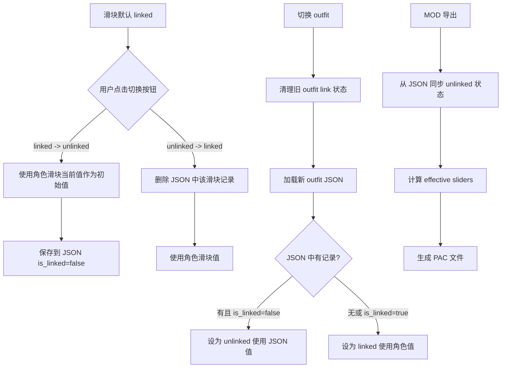

# Outfit Link/Unlink 逻辑修复方案

## 业务规则（用户定义）

1. **默认状态是 linked** — 跟随角色滑块参数
2. **仅当 `outfit_config/{char_id}.json` 中明确标记 `is_linked: false` 时**，才使用该 JSON 中保存的独立参数
3. **linked → unlinked 时**：直接删除 JSON 中该滑块的所有记录，采用默认 linked 状态（跟随角色滑块）
4. **不同 outfit 之间不能相互干扰** — 切换 outfit 时要更新 link/unlinked 状态

---

## 当前代码问题

### 问题 1: `_toggle_outfit_link()` — linked → unlinked 时应删除 JSON 记录

**当前代码**（[`ui_outfits.py:563-585`](core/ui_outfits.py:563)）：

当 `new_linked=True`（unlinked → linked）：
```python
# 当前：保存 is_linked=True 到 JSON（preserve_values=True）
self._save_slider_link_state(info, new_linked, preserve_values=True)
```

**问题**：按业务规则，linked 状态时 JSON 中不应有该滑块记录。当前代码反而把 `is_linked: true` 写入 JSON。

**应改为**：删除 JSON 中该滑块的记录。

---

### 问题 2: `_toggle_outfit_link()` — unlinked → linked 时不应读取 JSON

**当前代码**（[`ui_outfits.py:586-620`](core/ui_outfits.py:586)）：

当 `new_linked=False`（linked → unlinked）：
```python
# 当前：从 JSON 读取保存的参数
saved = self._load_saved_slider_config(info)
if saved:
    saved_min = float(saved.get("min", ...))
    saved_max = float(saved.get("max", ...))
    saved_val = float(saved.get("current_value", ...))
    ...
```

**问题**：按业务规则，linked → unlinked 时，滑块刚转为 unlinked 状态，应该使用当前角色滑块的参数作为初始值（因为之前是 linked 的）。不应从 JSON 读取（JSON 中没有该记录）。

---

### 问题 3: `load_sliders()` — 切换 outfit 时未清理旧 outfit 的 link 状态

**当前代码**（[`ui_outfits.py:370-388`](core/ui_outfits.py:370)）：

```python
for key, info in outfit_sliders_info.items():
    saved = self._load_saved_slider_config(info)
    is_linked = saved.get("is_linked", True) if saved else True

    if key not in self.main.outfit_link_states:
        self.main.outfit_link_states[key] = is_linked
```

**问题**：
- `outfit_link_states` 是全局字典，切换 outfit 时不会清理旧 outfit 的 key
- 虽然 `if key not in` 防止了覆盖，但旧 outfit 的 key 会一直残留
- 新 outfit 加载时，应该基于当前 outfit 的 JSON 数据重新初始化所有状态

**应改为**：切换 outfit 时，先清理旧 outfit 的 link 状态，再根据新 outfit 的 JSON 重新初始化。

---

### 问题 4: `OutfitConfigManager` 缺少 `delete_slider` 方法

当前 `OutfitConfigManager` 没有删除单个滑块记录的方法。需要添加以支持 linked → unlinked 时删除记录。

---

### 问题 5: MOD 导出逻辑需读取 JSON 中的 unlinked 状态

MOD 导出使用的是内存中的 `outfit_link_states` 等状态。但导出时可能没有激活 outfit（即没有加载 outfit sliders UI），所以这些内存状态可能是空的。

**解决方案**：在 MOD 导出时，从 `outfit_config/{char_id}.json` 文件读取 unlinked 状态，而不是依赖内存状态。

---

## 修复方案

### 修改 1: `OutfitConfigManager` — 添加 `delete_slider()` 方法

在 [`outfit_config_manager.py`](core/outfit_config_manager.py) 添加：

```python
def delete_slider(
    self, char_id: str, outfit_mod_path: str, short_id: str
) -> None:
    """
    Delete a single slider's config from outfit_config JSON.
    Called when switching from unlinked to linked.
    """
    data = self._read_file(char_id)
    if outfit_mod_path in data:
        data[outfit_mod_path].pop(short_id, None)
        # Clean up empty mod_path entries
        if not data[outfit_mod_path]:
            del data[outfit_mod_path]
        self._write_file(char_id, data)
```

### 修改 2: `_toggle_outfit_link()` — 重写 linked/unlinked 转换逻辑

在 [`ui_outfits.py:555-620`](core/ui_outfits.py:555)：

**unlinked → linked（`new_linked=True`）**：
```python
if new_linked:
    # 删除 JSON 中该滑块的记录
    ocm = getattr(self.main, "outfit_config_mgr", None)
    if ocm and self._outfit_mod_path:
        short_id = info.get("short_id", "")
        ocm.delete_slider(self.char_id, self._outfit_mod_path, short_id)
    
    # 使用角色滑块值
    if char_slider_id and char_slider_id in self.main.sliders_info:
        char_val = self.main.sliders_info[char_slider_id].get("current_value", 0.0)
        info["current_value"] = char_val
        self.main.outfit_slider_values[outfit_key] = char_val
        # 更新 UI...
```

**linked → unlinked（`new_linked=False`）**：
```python
else:
    # 使用当前角色滑块的参数作为初始值
    char_val = 0.0
    char_min = float(info.get("min", -50))
    char_max = float(info.get("max", 150))
    
    if char_slider_id and char_slider_id in self.main.sliders_info:
        char_val = self.main.sliders_info[char_slider_id].get("current_value", 0.0)
    
    info["current_value"] = char_val
    self.main.outfit_slider_values[outfit_key] = char_val
    
    # 保存到 JSON（is_linked=False）
    self._save_slider_config(info, char_val)
```

### 修改 3: `load_sliders()` — 清理旧 outfit 状态

在 [`ui_outfits.py:349-388`](core/ui_outfits.py:349)：

```python
def load_sliders(self, outfit_sliders_info, outfit_mod_path=""):
    self.clear_sliders()
    self._outfit_mod_path = outfit_mod_path
    
    if not outfit_sliders_info:
        return
    
    # 清理旧 outfit 的 link 状态
    old_keys = set(self.main.outfit_link_states.keys())
    new_keys = set(outfit_sliders_info.keys())
    for key in old_keys - new_keys:
        self.main.outfit_link_states.pop(key, None)
        self.main.outfit_slider_values.pop(key, None)
        self.main.outfit_slider_mapping.pop(key, None)
    
    # 根据当前 outfit 的 JSON 重新初始化
    for key, info in outfit_sliders_info.items():
        saved = self._load_saved_slider_config(info)
        # 仅当 JSON 中有记录且 is_linked=False 时，才视为 unlinked
        if saved and not saved.get("is_linked", True):
            is_linked = False
        else:
            is_linked = True
        
        self.main.outfit_link_states[key] = is_linked
        
        if not is_linked and saved:
            # Unlinked: 使用 JSON 中的独立值
            self.main.outfit_slider_values[key] = saved.get(
                "current_value", info.get("current_value", 0.0)
            )
        else:
            # Linked: 使用角色滑块值
            self.main.outfit_slider_values[key] = info.get("current_value", 0.0)
        
        self.main.outfit_slider_mapping[key] = info.get("char_slider_id")
```

### 修改 4: MOD 导出 — 从 JSON 读取 unlinked 状态

在 [`body_slider_func.py`](core/body_slider_func.py) 的 `package_and_export_mod()` 中：

导出前，从 `outfit_config/{char_id}.json` 读取当前激活 outfit 的 unlinked 状态，填充到 `outfit_link_states` 等字典中。

```python
# 在创建 worker 之前，确保 outfit 状态来自 JSON
self._sync_outfit_state_from_json()

def _sync_outfit_state_from_json(self):
    """从 outfit_config JSON 同步 unlinked 状态到内存。"""
    char_id = self.active_char_id
    if not char_id:
        return
    
    ocm = getattr(self, "outfit_config_mgr", None)
    if not ocm:
        return
    
    # 获取当前激活 outfit 的 mod_path
    mod_path = getattr(self, "active_outfit_mod_path", None)
    if not mod_path:
        return
    
    all_config = ocm.get_all_for_char(char_id)
    outfit_config = all_config.get(mod_path, {})
    
    # 更新 outfit_link_states
    for short_id, slider_data in outfit_config.items():
        outfit_key = f"outfit_{short_id}"
        if not slider_data.get("is_linked", True):
            self.outfit_link_states[outfit_key] = False
            self.outfit_slider_values[outfit_key] = slider_data.get("current_value", 0.0)
```

---

## 修改文件清单

| 文件 | 修改内容 |
|------|---------|
| `core/outfit_config_manager.py` | 添加 `delete_slider()` 方法 |
| `core/ui_outfits.py` | 1. `_toggle_outfit_link()` 重写 linked/unlinked 逻辑<br>2. `load_sliders()` 添加旧状态清理 |
| `core/body_slider_func.py` | 添加 `_sync_outfit_state_from_json()` 方法，在 MOD 导出前调用 |

## 流程图


