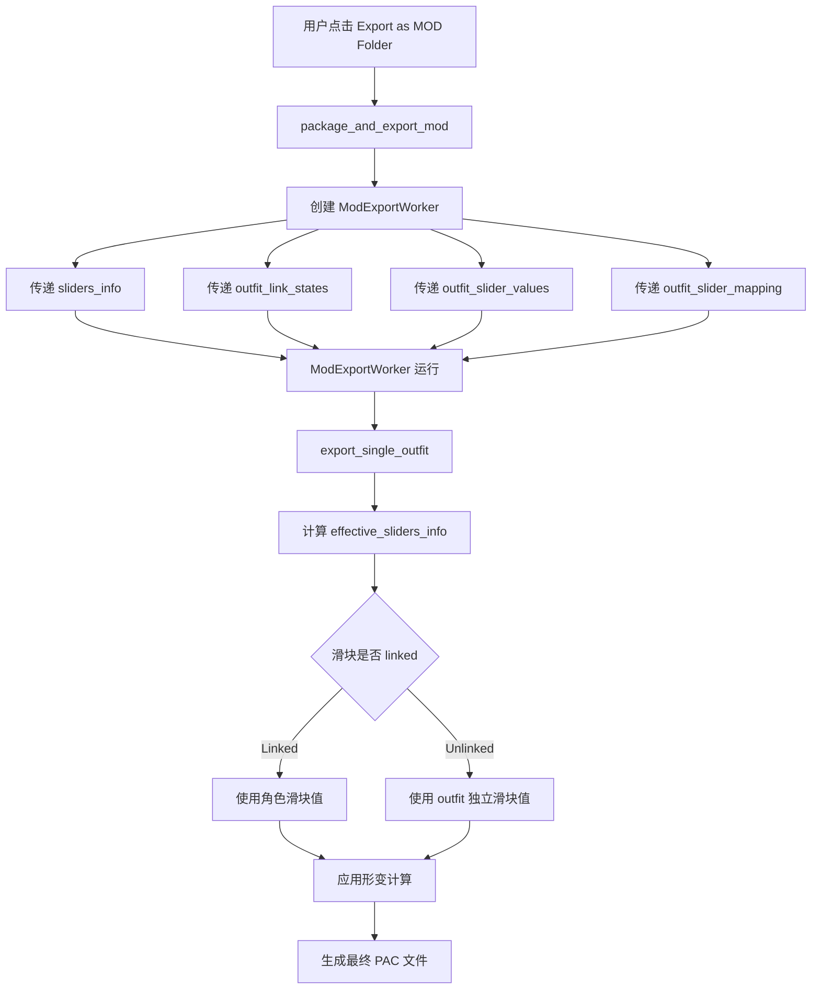

# Outfit MOD Export - Link/Unlink 逻辑修复方案

## 问题概述

当使用 "Export as MOD Folder" 按钮导出 outfit 文件时，导出的 .pac 文件**没有考虑滑块的 linked/unlinked 状态**，导致导出的 MOD 数据与 3D 预览中显示的模型不一致。

## 当前行为分析

### 3D 预览中的 outfit 形变计算（正确逻辑）

在 [`outfit_manager.py:450-505`](core/outfit_manager.py:450) 的 `update_outfit_morphs()` 方法中：

```python
# 根据 link_states 构建 effective_sliders_info
sliders_info = h.sliders_info
link_states = h.outfit_link_states or {}
slider_values = h.outfit_slider_values or {}
slider_mapping = h.outfit_slider_mapping or {}

if link_states:
    effective_info: Dict[str, Dict[str, Any]] = dict(sliders_info)
    for outfit_key, linked in link_states.items():
        if not linked:  # 解链：使用 outfit 独立滑块值
            char_sid = slider_mapping.get(outfit_key)
            if char_sid and char_sid in effective_info:
                val = slider_values.get(outfit_key, 0.0)
                entry = dict(effective_info[char_sid])
                entry["current_value"] = val  # 覆盖为 outfit 独立值
                effective_info[char_sid] = entry
    sliders_info = effective_info

# 使用 effective_info 计算形变
outfit_morphed = h.apply_morphs(
    h.outfit_original_points,
    outfit_morph_data,
    sliders_info,  # <-- 已处理 link/unlink
)
```

**核心逻辑：**
- **Linked（🔗）**：使用角色主体的滑块值（`sliders_info[char_sid].current_value`）
- **Unlinked（⛓️‍💥）**：使用 outfit 独立的滑块值（`outfit_slider_values[outfit_key]`），该值存储在 `outfit_config/{char_id}.json` 中

### MOD 导出中的 outfit 形变计算（当前有问题的逻辑）

在 [`body_slider_func.py`](core/body_slider_func.py) 的 `ModExportWorker.export_single_outfit()` 方法中（约第 2170 行）：

```python
for sid, info in self.sliders_info.items():
    md = outfit_morph_data.get(sid)
    cv = info.get("current_value", 0.0)  # <-- 直接使用 sliders_info 的值
    if md is not None and name in md:
        morphed += md[name] * (cv / 100.0)
```

**问题：** 直接使用 `self.sliders_info` 中的 `current_value`，完全没有考虑：
1. `outfit_link_states` - 哪些滑块是 unlinked 的
2. `outfit_slider_values` - unlinked 滑块的独立值
3. `outfit_slider_mapping` - outfit 滑块到角色滑块的映射

### 数据传递链路

`package_and_export_mod()` 创建 `ModExportWorker` 时（[`body_slider_func.py:2356-2365`](core/body_slider_func.py:2356)）：

```python
worker_obj = self.ModExportWorker(
    char_id=char_id,
    original_pac=original_pac,
    mod_path=mod_path,
    mod_dir=mod_dir,
    files_dir=files_dir,
    char_name=char_name,
    sliders_info=self.sliders_info,  # <-- 只传了这个
    root_dir=self.root_dir,
)
```

**缺失的参数：**
- `outfit_link_states: Dict[str, bool]`
- `outfit_slider_values: Dict[str, float]`
- `outfit_slider_mapping: Dict[str, Optional[str]]`

## 修复方案

### 方案：复用 3D 预览的 effective sliders 计算逻辑

#### 修改 1：`ModExportWorker.__init__()` 增加参数

在 [`body_slider_func.py:1800-1817`](core/body_slider_func.py:1800) 的构造函数中添加三个新参数：

```python
def __init__(self, char_id: str, original_pac: str, mod_path: str,
             mod_dir: str, files_dir: str, char_name: str,
             sliders_info: Dict[str, Dict], root_dir: str,
             outfit_link_states: Dict[str, bool] = None,
             outfit_slider_values: Dict[str, float] = None,
             outfit_slider_mapping: Dict[str, Optional[str]] = None):
    # ... existing code ...
    self.outfit_link_states = outfit_link_states or {}
    self.outfit_slider_values = outfit_slider_values or {}
    self.outfit_slider_mapping = outfit_slider_mapping or {}
```

#### 修改 2：`export_single_outfit()` 内计算 effective current_value

在计算 outfit 形变顶点位置时（约第 2167-2175 行），将：

```python
# 当前代码（有问题）
for sid, info in self.sliders_info.items():
    md = outfit_morph_data.get(sid)
    cv = info.get("current_value", 0.0)
```

改为：

```python
# 构建 effective sliders_info（与 update_outfit_morphs 逻辑一致）
effective_info = dict(self.sliders_info)
link_states = self.outfit_link_states
slider_values = self.outfit_slider_values
slider_mapping = self.outfit_slider_mapping

if link_states:
    for outfit_key, linked in link_states.items():
        if not linked:
            char_sid = slider_mapping.get(outfit_key)
            if char_sid and char_sid in effective_info:
                val = slider_values.get(outfit_key, 0.0)
                entry = dict(effective_info[char_sid])
                entry["current_value"] = val
                effective_info[char_sid] = entry

# 使用 effective_info 计算形变
for sid, info in effective_info.items():
    md = outfit_morph_data.get(sid)
    cv = info.get("current_value", 0.0)
```

#### 修改 3：`package_and_export_mod()` 传递 outfit 状态数据

在 [`body_slider_func.py:2356-2365`](core/body_slider_func.py:2356) 创建 worker 时：

```python
worker_obj = self.ModExportWorker(
    char_id=char_id,
    original_pac=original_pac,
    mod_path=mod_path,
    mod_dir=mod_dir,
    files_dir=files_dir,
    char_name=char_name,
    sliders_info=self.sliders_info,
    root_dir=self.root_dir,
    # 新增参数
    outfit_link_states=self.outfit_link_states,
    outfit_slider_values=self.outfit_slider_values,
    outfit_slider_mapping=self.outfit_slider_mapping,
)
```

### 同时检查 `_export_outfit_pacs()` 方法

[`body_slider_func.py:2560-2747`](core/body_slider_func.py:2560) 的 `_export_outfit_pacs()` 方法也存在同样的问题。如果该方法被调用（需要确认调用入口），需要应用相同的修复逻辑。

## 修改文件清单

| 文件 | 修改内容 |
|------|---------|
| `core/body_slider_func.py` | 1. `ModExportWorker.__init__()` 添加 3 个参数<br>2. `export_single_outfit()` 内添加 effective sliders 计算逻辑<br>3. `package_and_export_mod()` 传递 outfit 状态数据 |

## 验证方法

1. 创建一个有 outfit 的角色
2. 激活一个 outfit
3. 将某些滑块设为 unlinked（⛓️‍💥），并调整到与角色滑块不同的值
4. 确认 3D 预览中 outfit 显示的是 unlinked 值对应的形变
5. 点击 "Export as MOD Folder"
6. 导出后，用导出 MOD 覆盖游戏文件，确认游戏中 outfit 显示与 3D 预览一致

## 流程图


