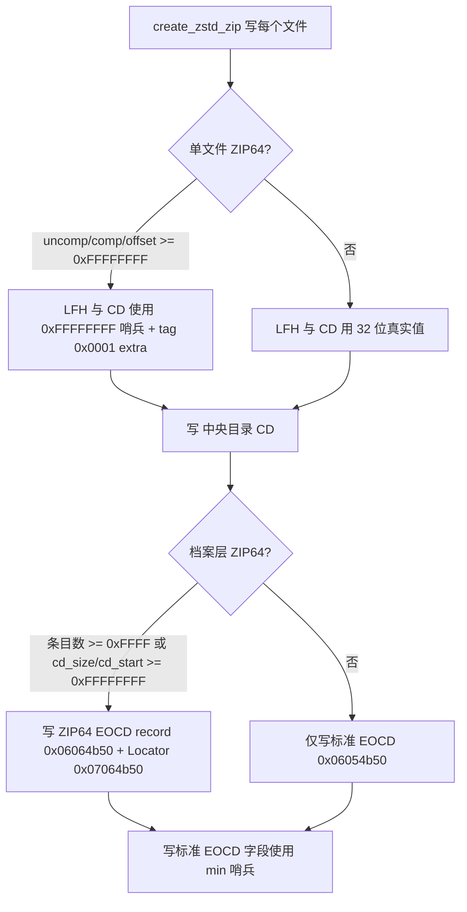

# 导出角色包 ZIP64 支持方案

## 1. 背景与现状

当前导出角色包（[`PackHandlerMixin.export_character_pack()`](core/pack_handler_mixin.py:114) → [`create_zip()`](core/zip_utils.py:458) → [`create_zstd_zip()`](core/zip_utils.py:397)）在默认 Zstd 压缩路径下**不支持 ZIP64**：

- [`_write_local_header()`](core/zip_utils.py:324) / [`_write_cd_entry()`](core/zip_utils.py:357) 中所有大小/偏移字段都用 `<I`（uint32），且 `extra_len = 0`
- EOCD（第 444 行）使用 uint32，无 ZIP64 EOCD 记录、无 ZIP64 EOCD Locator

限制：单文件 ≤ ~4 GB、条目数 ≤ ~42 亿、档案总大小 ≤ ~4 GB。对一般角色包够用，但超大资源包会失败。

DEFLATED 回退路径（[`create_zip()`](core/zip_utils.py:458) 第 495 行）走 Python `zipfile.ZipFile`，**已自动支持 ZIP64**。

读取方向（导入）依赖 `zipfile.ZipInfo.compress_size`，已支持 ZIP64，无需改动。

## 2. 参考实现 Bug 审计

参考实现：`D:\My_Projects\Game Mods\Crimson Desert\Body Slider Outfitter\source\core\zip_utils.py`

审计 `_ZipWriter._write_end_zip64()`（第 165-182 行）及字段写入逻辑，发现以下问题。**参考实现不可直接照搬**，需在移植时修正。

### 2.1 [致命] ZIP64 EOCD 与 Locator 的签名字节互换

ZIP 规范：
- ZIP64 end of central directory **record** 签名 = `0x06064b50`（PK\x06\x06）
- ZIP64 end of central directory **locator** 签名 = `0x07064b50`（PK\x06\x07）

参考实现把它们写反了：

```python
# ZIP64 End of Central Directory
self._file.write(struct.pack("<I", 0x07064b50))  # ← 错：应为 0x06064b50
...
# ZIP64 End of Central Directory Locator
self._file.write(struct.pack("<I", 0x06064b50))  # ← 错：应为 0x07064b50
```

后果：任何符合规范的解压器都无法识别 ZIP64 记录，整个档案读取会从 ZIP64 EOCD 回退到标准 EOCD，但由于标准 EOCD 在 ZIP64 场景下写了 0xFFFFFFFF 哨兵，解压器会进一步尝试找 ZIP64 记录失败 → 档案不可读。

**修正**：互换两个签名字面量。

### 2.2 [致命] ZIP64 EOCD Locator 的 offset 字段写入错误

```python
# ZIP64 End of Central Directory Locator
self._file.write(struct.pack("<I", 0x06064b50))  # sig
self._file.write(struct.pack("<I", 0))  # disk with zip64 eocd
self._file.write(struct.pack("<Q", self._file.tell()))  # ← BUG
self._file.write(struct.pack("<I", 1))  # total disks
```

`self._file.tell()` 在写入 sig(4) + disk(4) 之后调用，此时文件指针指向 Locator 内部的 offset 字段自身位置，而不是 ZIP64 EOCD **record** 的起始偏移。

后果：Locator 指向自己内部，解压器根据 Locator 找不到 ZIP64 EOCD 记录。

**修正**：在写入 ZIP64 EOCD 记录之前先用 `zip64_eocd_offset = self._file.tell()` 记录起始位置，Locator 中写该值：

```python
def _write_end_zip64(self, central_offset, central_size):
    zip64_eocd_offset = self._file.tell()
    # ... 写 ZIP64 EOCD record ...
    # Locator
    self._file.write(struct.pack("<I", 0x07064b50))
    self._file.write(struct.pack("<I", 0))
    self._file.write(struct.pack("<Q", zip64_eocd_offset))
    self._file.write(struct.pack("<I", 1))
```

### 2.3 [Bug] Local header 的 ZIP64 extra field 错误包含 local_offset

ZIP 规范：
- Local file header 的 ZIP64 extra field（tag 0x0001）可含：original uncompressed size、compressed size、disk start number
- Central directory entry 的 ZIP64 extra field 可含：original size、compressed size、disk start、**relative offset of local header**

local_header_offset 字段**只能**出现在 central directory 的 extra field 中，绝不能出现在 local header 的 extra field 中（local header 不可能引用自己的偏移）。

参考实现用同一个 `extra_data` 写入两处，导致 local header 的 extra field 也含 `local_offset`：

```python
if _has_offset:
    zip64_extra.extend(struct.pack("<Q", local_offset))  # 会同时写入 LFH 与 CD
...
self._file.write(extra_data)        # LFH：违规含 offset
self._central_dir.write(extra_data) # CD：合规
```

多数解压器会忽略多余字段，但严格遵守规范的解压器（如部分 ZIP 校验工具）可能拒绝。

**修正**：分别为 LFH 与 CD 构造 extra field。LFH 的 extra 只含 `_has_uncomp` / `_has_comp`；CD 的 extra 另行追加 `_has_offset`（disk start 在单磁盘下不溢出，省略）。

### 2.4 [小] end_offset 形参未使用

`_write_end_zip64(self, central_offset, central_size, end_offset)` 的 `end_offset` 形参从未使用（死参数）。

**修正**：删除该形参，调用处同步调整。ZIP64 触发判断中 `end_offset >= 0xFFFFFFFF` 可保留（用于检测文件总大小溢出 4 GB）。

### 2.5 [小] ZIP64 触发判断遗漏 central_size 检查

```python
if self._entries >= 0xFFFF or end_offset >= 0xFFFFFFFF or central_offset >= 0xFFFFFFFF:
```

缺少 `central_size >= 0xFFFFFFFF`。central directory 自身超过 4 GB 的概率极低（需数千万条目），但严谨做法应补上。

**修正**：补 `or central_size >= 0xFFFFFFFF`。

### 2.6 [依赖不兼容] zstandard vs zstd 包 API

参考实现顶部 `import zstandard as zstd`，使用 `zstd.ZstdCompressor(level=...)` / `zstd.ZstdDecompressor()` 的类式流式 API。

本项目的依赖（[requirements.txt](requirements.txt:5)）是 `zstd` 包，API 为：

- `zstd.compress(data: bytes, level: int) -> bytes`
- `zstd.decompress(data: bytes) -> bytes`
- `has_zstd()` / `_get_zstd()` 懒加载（[core/zip_utils.py:35](core/zip_utils.py:35)）

**修正**：移植时不能照搬 `ZstdCompressor` 类；继续用 `_get_zstd().compress(data, level)`，保持懒加载与回退逻辑，不动 requirements.txt。

### 2.7 [范围] 参考实现附带完整 ZipReader

参考实现带 `ZipReader`/`_ZipReader` 自研解析器，当前项目读取走 `zipfile.ZipFile` + `_read_raw_compressed`。本任务范围只限"导出 ZIP64"，**读取端不动**（已支持 ZIP64）。

> 若后续要统一读写两端（例如彻底脱离 zipfile 以自管 Method 93），另立任务评估。

## 3. 实施方案

核心：在当前 [`core/zip_utils.py`](core/zip_utils.py) 的 `create_zstd_zip` 写入路径上"原位"添加 ZIP64 支持，同时修正参考实现列出的所有 bug，保持 `zstd` 包 API、DEFLATED 回退路径与对外签名不变。

### 3.1 不变的对外契约

[export_character_pack()](core/pack_handler_mixin.py:263) 调用保持原样：

```python
create_zip(
    output_path=out_path,
    file_list=full_file_list,
    progress_callback=_progress_cb,
    use_zstd=True,
    zstd_level=3,
)
```

`create_zip(output_path, file_list, progress_callback, use_zstd, zstd_level)` 签名与语义不变；`create_zstd_zip(output_path, file_list, progress_callback, compress_level)` 签名与语义不变。读取端公共函数（`extract_zip` / `read_zip_string` / `decompress_entry` / `compress_to_zst` / `decompress_zst_file` / `has_zstd`）**全部不动**。

### 3.2 改造 `_write_local_header` / `_write_cd_entry`

新签名（增加 ZIP64 判定）：

```python
def _write_local_header(f, filename, comp_data, uncomp_data, comp_type, mtime,
                        need_zip64: bool):
    # sizes 字段：溢出时写 0xFFFFFFFF 哨兵，否则写真实值
    # extra field：仅当 need_zip64 为真时构造 tag 0x0001，仅含
    #   [uncompressed_size] [compressed_size]（按溢出条件追加），不含 offset
```

```python
def _write_cd_entry(f, filename, comp_data, uncomp_data, comp_type, mtime,
                    header_offset, need_zip64: bool):
    # central sizes 同上
    # local header offset：溢出时写 0xFFFFFFFF 哨兵
    # extra field：tag 0x0001 含 [uncompressed_size] [compressed_size] [local_offset]（按溢出条件追加）
```

ZIP64 extra field 字段顺序（严格遵守规范）：original uncompressed size → compressed size → disk start number（单磁盘省略）→ local header offset（仅 CD）。

`version_needed`：当 `need_zip64` 为真时抬升到 45（4.5）。

### 3.3 新增 `_write_zip64_end` 辅助函数

```python
def _write_zip64_end(f, entries, central_offset, central_size):
    """写 ZIP64 EOCD record + Locator。必须在标准 EOCD 之前调用。"""
    zip64_eocd_offset = f.tell()  # 先记录 record 起始

    # ZIP64 EOCD record (签名 0x06064b50)
    f.write(struct.pack('<I', 0x06064b50))
    f.write(struct.pack('<Q', 44))                 # size of record (固定 44)
    f.write(struct.pack('<HH', 45, 45))            # version made by / needed
    f.write(struct.pack('<I', 0))                  # this disk
    f.write(struct.pack('<I', 0))                  # disk with CD start
    f.write(struct.pack('<Q', entries))            # entries on this disk
    f.write(struct.pack('<Q', entries))            # total entries
    f.write(struct.pack('<Q', central_size))       # CD size
    f.write(struct.pack('<Q', central_offset))     # CD offset

    # ZIP64 EOCD locator (签名 0x07064b50)
    f.write(struct.pack('<I', 0x07064b50))
    f.write(struct.pack('<I', 0))                  # disk with zip64 eocd
    f.write(struct.pack('<Q', zip64_eocd_offset))  # offset of zip64 eocd record
    f.write(struct.pack('<I', 1))                  # total disks
```

签名顺序与 offset 字段是修正 2.1 / 2.2 的关键。

### 3.4 改造 `create_zstd_zip` 主循环与 EOCD

```python
for idx, (src_path, arcname) in enumerate(file_list, 1):
    uncomp_data = ...
    comp_data = zstd.compress(uncomp_data, compress_level)   # 保持 zstd 包 API
    header_offset = f.tell()
    need_zip64_entry = (
        len(uncomp_data) >= 0xFFFFFFFF
        or len(comp_data) >= 0xFFFFFFFF
        or header_offset >= 0xFFFFFFFF
    )
    _write_local_header(f, filename_bytes, comp_data, uncomp_data, 93, mtime,
                        need_zip64=need_zip64_entry)
    # 记录 CD 用元组：包含 need_zip64 标志
    cd_entries.append((filename_bytes, comp_data, uncomp_data, mtime,
                       header_offset, need_zip64_entry))
    ...

# 写 CD
cd_start = f.tell()
cd_size = 0
for entry in cd_entries:
    before = f.tell()
    _write_cd_entry(f, *entry)
    cd_size += f.tell() - before

# 写 EOCD（含 ZIP64 判定）
need_zip64_archive = (
    len(cd_entries) >= 0xFFFF
    or cd_size >= 0xFFFFFFFF
    or cd_start >= 0xFFFFFFFF
)
if need_zip64_archive:
    _write_zip64_end(f, len(cd_entries), cd_start, cd_size)

f.write(struct.pack('<IHHHHIIH', 0x06054b50, 0, 0,
    min(len(cd_entries), 0xFFFF), min(len(cd_entries), 0xFFFF),
    min(cd_size, 0xFFFFFFFF), min(cd_start, 0xFFFFFFFF), 0))
```

要点：
- ZIP64 触发判定在 entry 层（单文件大小/偏移）与 archive 层（条目数/CD 大小/CD 偏移）双重进行。
- ZIP64 EOCD 位于标准 EOCD 之前；标准 EOCD 的字段在 ZIP64 场景下用 `min()` 自动转为 0xFFFF/0xFFFFFFFF 哨兵，触发解压器查找 ZIP64 记录。

### 3.5 不动的部分

- DEFLATED 回退路径（[`create_zip()`](core/zip_utils.py:493) 的 `else` 分支）保持原样（zipfile 自动 ZIP64）。
- 读取端全部函数不动。
- [`export_character_pack()`](core/pack_handler_mixin.py:263) 调用点不动。

### 3.6 ZIP64 判定与触发总览



## 4. 影响范围

| 模块 | 改动 |
|---|---|
| [`core/zip_utils.py`](core/zip_utils.py) | 重写 `_write_local_header` / `_write_cd_entry`，新增 `_write_zip64_end`，改造 `create_zstd_zip` 主循环与 EOCD |
| [`core/pack_handler_mixin.py`](core/pack_handler_mixin.py) | 无（调用点签名不变） |
| [`requirements.txt`](requirements.txt) | 无（仍用 `zstd` 包） |
| 读取端 | 无 |

## 5. 验证步骤

1. **回归（小档案，未触发 ZIP64）**：导出普通角色包，用 `zipfile.ZipFile` 读取 + [`extract_zip`](core/zip_utils.py:164) 解压，对比与改动前产物一致（条目数 / CRC / 大小）。
2. **ZIP64 触发（条目数溢出）**：构造一个含 ≥ 65536 个小文件的临时 `file_list` 调用 `create_zstd_zip`，确认生成的档案能被 `zipfile.ZipFile`（`allowZip64=True` 缺省）正确列出所有条目并读取，且 `ZipFile.infolist()` 中条目数正确。
3. **ZIP64 触发（单文件 > 4 GB）**：用 `os.urandom` 生成伪 4 GB+ 数据（或用稀疏文件 + monkey patch 长度判定），验证 ZIP64 extra field 与哨兵；至少用一个真实超过 4 GB 的文件（或用 `dd`/PowerShell 稀疏文件构造）确认 round-trip。
4. **签名校验**：对 ZIP64 档案手动 `xxd` 检查末尾，确认出现 `50 4b 06 06`（ZIP64 EOCD record）和 `50 4b 06 07`（Locator）且 Locator 的 offset 指向 EOCD record 起始位置。
5. **DEFLATED 回退**：临时令 `has_zstd()` 返回 False，确认导出仍正常且档案读得回。
6. **跨工具校验**：用 `7z l` 或 `unzip -l` 列出 ZIP64 档案条目，确认无报错（解压器对 ZIP64 extra field 容错性兜底）。

## 6. 待办（Code 模式执行）

- [ ] 改写 `_write_local_header` / `_write_cd_entry`，增加 `need_zip64` 参数与 ZIP64 extra field 构造
- [ ] 新增 `_write_zip64_end` 辅助函数（修正参考实现签名互换与 offset 错误）
- [ ] 改造 `create_zstd_zip` 主循环：单文件 ZIP64 判定、CD 记录、EOCD + ZIP64 判定
- [ ] 保持 `create_zip` 对外签名不变，DEFLATED 回退路径不动
- [ ] 验证步骤 1（小档案回归）与步骤 4（签名校验）必做；2/3/5/6 视条件允许
