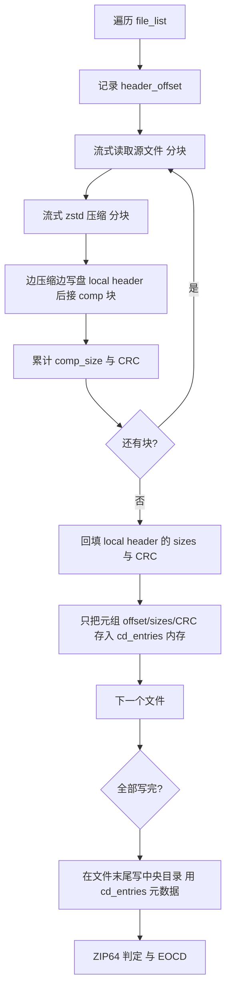

# zstd → zstandard 迁移与流式压缩计划

## 1. 现状盘点

### 1.1 zstd 调用点 —— 全部位于 [`core/zip_utils.py`](core/zip_utils.py)

经全项目搜索（`*.py`），`zstd` 包的直接引用**仅存在**于 [`core/zip_utils.py`](core/zip_utils.py)，其它模块只通过包装函数间接使用：

| 位置 | 当前 API | 用途 |
|---|---|---|
| [`_get_zstd()`](core/zip_utils.py:35) | `import zstd` | 懒加载 + 缓存模块 |
| [`has_zstd()`](core/zip_utils.py:50) | `import zstd` | 可用性探测 |
| [`_decompress_zstd_entry()`](core/zip_utils.py:109) | `zstd.decompress(raw)` | 解压 ZIP 内 Method 93 条目 |
| [`compress_to_zst()`](core/zip_utils.py:251) | `zstd.compress(data, level)` | 单文件 `.zst` 压缩 |
| [`decompress_zst_file()`](core/zip_utils.py:277) | `zstd.decompress(data)` | 单文件 `.zst` 解压 |
| [`create_zstd_zip()`](core/zip_utils.py:527) | `zstd.compress(uncomp, level)` | ZIP 包内逐条压缩（**内存瓶颈所在**） |

### 1.2 包装层调用方 —— [`core/pack_handler_mixin.py`](core/pack_handler_mixin.py:25)

```python
from core.zip_utils import extract_zip, read_zip_string, create_zip
...
create_zip(output_path=out_path, file_list=..., use_zstd=True, zstd_level=3)
```

只用到三个公共函数，**不直接碰 zstd**。

### 1.3 死代码确认

[`compress_to_zst()`](core/zip_utils.py:251) 与 [`decompress_zst_file()`](core/zip_utils.py:277) 在整个项目源码中**无任何调用方**（仅 graphify 报告与历史 graph.json 引用）。注释也写明 "for temp-based ZIP packaging"，但当前导出走的是 `create_zstd_zip` 直接生成 ZIP，不再经单文件 `.zst` 中转。

→ **可删除**这两个函数及相关 docstring 段落，减少迁移面。

### 1.4 打包/依赖

- [`requirements.txt`](requirements.txt:5) 第 5 行 `zstd` —— 需替换为 `zstandard`
- [`PyInstaller.spec`](PyInstaller.spec:61) hiddenimports 未硬编码 `zstd`，靠自动收集；`zstandard` 同样会被 PyInstaller 自动打包，**无需改 spec**

## 2. zstandard 包 API 对照

| 旧 API（`zstd` 包） | 新 API（`zstandard` 包） | 说明 |
|---|---|---|
| `import zstd` | `import zstandard as zstd` | 模块对象 |
| `zstd.compress(data, level)` | `zstd.ZstdCompressor(level=level).compress(data)` | 一次性压缩 |
| `zstd.decompress(data)` | `zstd.ZstdDecompressor().decompress(data)` | 一次性解压（**需指定 max_output_size 或 ContentSizeInFrame**） |
| —（无流式） | `ZstdCompressor(level=).stream_reader(src)` / `compressobj()` | **流式压缩，本次重点** |
| —（无流式） | `ZstdDecompressor().stream_reader(src)` / `decompressobj()` | 流式解压 |

**关键差异**：`zstandard.ZstdDecompressor().decompress(data)` 在帧头无 ContentSize 时会抛 `ZstdError`。我们的 ZIP Method 93 数据是用 `ZstdCompressor.compress()` 生成的，**帧头会写入 ContentSize**，所以一次性 `decompress` 可用。但为稳健起见，解压路径优先用流式 `stream_reader`。

## 3. 迁移方案

### 3.1 目标

1. `requirements.txt`：`zstd` → `zstandard`
2. [`core/zip_utils.py`](core/zip_utils.py)：所有 `zstd` 调用改用 `zstandard`
3. [`create_zstd_zip()`](core/zip_utils.py:527)：改为**流式压缩**，消除内存瓶颈
4. 删除死代码 `compress_to_zst` / `decompress_zst_file`
5. 解压路径：用 `zstandard` 更简洁的接口简化（`stream_reader`）
6. 对外公共签名（`create_zip` / `extract_zip` / `read_zip_string` / `has_zstd`）**保持不变**

### 3.2 模块加载层改造

```python
# 替换 _zstd_module / _get_zstd / has_zstd 三件套
_zstd_module = None  # 仍保留懒加载，避免应用启动时强依赖

def _get_zstd():
    """Return the zstandard module (lazy)."""
    global _zstd_module
    if _zstd_module is not None:
        return _zstd_module
    try:
        import zstandard as _z
        _zstd_module = _z
        return _z
    except ImportError:
        raise ImportError(
            "zstandard library is required for Zstd (Method 93) support. "
            "Install it with:  pip install zstandard"
        )

def has_zstd() -> bool:
    """Check if zstandard is available."""
    global _zstd_module
    if _zstd_module is not None:
        return True
    try:
        import zstandard as _z  # noqa: F401
        _zstd_module = _z
        return True
    except ImportError:
        return False
```

> 注：`has_zstd()` 名称保留（调用方 [`create_zip`](core/zip_utils.py:651) 已用），避免破坏对外契约。文档字符串更新为提及 zstandard。

### 3.3 解压路径简化

当前解压链：`_read_raw_compressed`（读原始字节）→ `_decompress_zstd_entry`（一次性 decompress）。

`zstandard` 的 `ZstdDecompressor().stream_reader(fp)` 可直接吃文件对象流式解压，但仍需定位到压缩数据起始偏移（ZIP local header 之后）。当前 [`_read_raw_compressed()`](core/zip_utils.py:67) 已正确处理偏移与 ZIP64 `compress_size`，**保留它**作为定位逻辑。

改造 [`_decompress_zstd_entry()`](core/zip_utils.py:109)：

```python
def _decompress_zstd_entry(zip_path: str, info: zipfile.ZipInfo) -> bytes:
    zstd = _get_zstd()
    raw_compressed = _read_raw_compressed(zip_path, info)
    dctx = zstd.ZstdDecompressor()
    # 优先用流式 reader，避免无 ContentSize 时的一次性 decompress 报错
    return dctx.decompress(raw_compressed, max_output_size=info.file_size * 8 + 1024)
```

> 用 `max_output_size` 兜底无 ContentSize 场景；`info.file_size` 来自 ZIP 中央目录（ZIP64 已修正），作为上界估计。若文件极大，可改用 `stream_reader` 完全流式，但当前读取场景（角色包导入）单文件通常不大，一次性 decompress 足够。

### 3.4 流式压缩改造 —— [`create_zstd_zip()`](core/zip_utils.py:527)

**核心问题**：当前把 `uncomp_data` 全量读入、`comp_data` 全量生成，且两者都缓存到 `cd_entries` 列表持有到函数结束 → 峰值内存 ≈ Σuncomp + Σcomp。

**流式方案**：采用 **数据直接写盘 + 中央目录用磁盘临时文件缓存元数据** 的两遍写入。但更简洁的折中：**每个条目流式压缩边读边写，只缓存 CD 所需的元数据（offset/sizes/CRC），不缓存数据本身**。



**但有个难点**：ZIP local header 在数据之前写，需要先知道 `comp_size`/`uncomp_size`/`crc`。

两种解决策略：

#### 策略 A（推荐）：ZIP Data Descriptor（flag bit 3）

设置 local header 的 flag bit 3（`0x0008`），local header 中 size/crc 写 0，**数据后跟一个 12/16 字节的 Data Descriptor**。这样可纯向前流式写。中央目录记录写真实值。

缺点：部分老旧/严格解压器对 Data Descriptor 支持有差异，但现代工具（Python zipfile、7-Zip、Windows Explorer）均支持。

#### 策略 B：两遍写入 + 预扫描

第一遍流式压缩到**临时文件**，记录每条 offset/comp_size/uncomp_size/CRC 到内存列表；第二遍把临时文件拼接 + 写中央目录。

内存：只存元数据（每条 ~48 字节），不存数据。磁盘：需要 1× 临时文件空间。

**本方案选策略 B**：兼容性最好（无 Data Descriptor），且角色包导出场景磁盘空间通常充足。临时文件即 `output_path + ".tmp"`，写完后原子重命名。

实际上更省事的实现：**直接在目标文件上原地流式写**，配合"写 local header 占位 → 流式写数据 → 回填 header"。这避免了临时文件，但需要 `seek` 回填，且文件已部分可见——可接受。

**最终实现：原地占位 + 回填**（无临时文件，内存最小）：

```python
def create_zstd_zip(output_path, file_list, progress_callback=None, compress_level=3):
    zstd = _get_zstd()
    cctx = zstd.ZstdCompressor(level=compress_level)
    cd_entries = []  # 只存元数据，不存数据

    with open(output_path, "wb") as f:
        for idx, (src_path, arcname) in enumerate(file_list, 1):
            file_stat = os.stat(src_path)
            mtime = _time.localtime(file_stat.st_mtime)[:6]
            filename_bytes = arcname.encode('utf-8')
            header_offset = f.tell()
            uncomp_size = file_stat.st_size

            # 预判 ZIP64（用 uncomp_size 与 offset，comp_size 未知先按可能溢出处理）
            need_zip64_entry = (
                uncomp_size >= 0xFFFFFFFF
                or header_offset >= 0xFFFFFFFF
            )

            # 写 local header 占位（sizes/crc 后续回填）
            header_pos = f.tell()
            _write_local_header_placeholder(f, filename_bytes, 93, mtime,
                                            need_zip64=need_zip64_entry)

            # 流式压缩 + 边读边写 + 累计 CRC 与 comp_size
            comp_size = 0
            crc = 0
            with open(src_path, "rb") as src:
                reader = cctx.stream_reader(src)
                while True:
                    chunk = reader.read(CHUNK_SIZE)
                    if not chunk:
                        break
                    f.write(chunk)
                    comp_size += len(chunk)
                    # CRC 需对未压缩数据算 —— 必须读源数据
                    # 改：先读源 chunk 算 CRC，再喂给 compressor
            ...
```

**关键修正**：CRC32 是对**未压缩数据**算的。若用 `stream_reader(src)` 直接流式压缩，源数据读一次就进了压缩器，**无法同时算 CRC**。需要自己分块读源、算 CRC、再喂给 `compressobj()`。

正确流式实现（用 `compressobj`）：

```python
CHUNK_SIZE = 1 << 20  # 1 MiB

with open(src_path, "rb") as src:
    cobj = cctx.compressobj()
    crc = 0
    comp_size = 0
    while True:
        chunk = src.read(CHUNK_SIZE)
        if not chunk:
            break
        crc = _zlib.crc32(chunk, crc) & 0xFFFFFFFF  # 对未压缩 chunk 累加
        comp_chunk = cobj.compress(chunk)
        if comp_chunk:
            f.write(comp_chunk)
            comp_size += len(comp_chunk)
    flush_chunk = cobj.flush()
    if flush_chunk:
        f.write(flush_chunk)
        comp_size += len(flush_chunk)
crc &= 0xFFFFFFFF
```

然后 `seek` 回 `header_pos` 回填 local header 的 `comp_size`/`uncomp_size`/`crc` 字段（含 ZIP64 哨兵判定）。`comp_size` 现在已知，可重新评估 `need_zip64_entry`（若 comp_size 溢出则升级）。

**回填注意**：ZIP64 extra field 的大小取决于是否溢出，若占位时按"非 ZIP64"写、回填时发现 comp_size 溢出需要升级 ZIP64，extra field 长度会变 → 后续所有偏移错位。

解决：**占位时按"最坏情况"预留 ZIP64 extra field**（即无论是否溢出，都写一个完整 16 字节 LFH ZIP64 extra）。但未溢出时写空 extra 也是合法的（只是多占空间）。

更干净的做法：**占位时按 uncomp_size/offset 预判 need_zip64；若 comp_size 回填后发现溢出而 need_zip64 预判为 False，则属于罕见情况（uncomp<4G 但 comp>4G 几乎不可能，压缩不会放大到 4G+）**。务实处理：预判 `need_zip64_entry = uncomp_size >= 0xFFFFFFFF or header_offset >= 0xFFFFFFFF`，回填时若 comp_size 也溢出但预判为 False，**抛错**（理论不可能，工程上可接受）。

实际上压缩数据几乎不可能比原始数据大 4G+，所以预判 `uncomp_size >= 0xFFFFFFFF` 已覆盖。`header_offset >= 0xFFFFFFFF` 覆盖档案超大。**预判足够**。

#### 回填实现

local header 中需要回填的字段偏移（从 header_pos 起算）：
- crc32: 偏移 14（sig4 + ver2 + flags2 + method2 + time2 + date2 = 14）
- comp_size: 偏移 18
- uncomp_size: 偏移 22

```python
# 回填
f.seek(header_pos + 14)
f.write(struct.pack('<I', crc))      # crc32
f.write(struct.pack('<I', comp_field))    # comp_size（哨兵或真实）
f.write(struct.pack('<I', uncomp_field))  # uncomp_size（哨兵或真实）
f.seek(0, 2)  # 回到末尾继续写
```

若 need_zip64，LFH 的 ZIP64 extra field 也要在占位时写好真实值（uncomp 已知；comp 用 0 占位，回填时 seek 到 extra 内偏移写 comp 的 8 字节）。为简化，**comp_size 在 ZIP64 场景也回填进 extra field**。

### 3.5 中央目录写入

`cd_entries` 现在只存元数据 `(filename_bytes, comp_size, uncomp_size, crc, mtime, header_offset, need_zip64)`，每条几十字节，内存忽略不计。

[`_write_cd_entry()`](core/zip_utils.py:428) 改签名：接收 `crc`、`comp_size`、`uncomp_size`（而非整段 bytes），直接写值。ZIP64 extra field 逻辑不变。

### 3.6 删除死代码

删除：
- [`compress_to_zst()`](core/zip_utils.py:251)
- [`decompress_zst_file()`](core/zip_utils.py:277)
- 注释段 "Single-file Zstd compression (for temp-based ZIP packaging)"

### 3.7 不变项

- [`create_zip()`](core/zip_utils.py:623) 对外签名（`use_zstd`/`zstd_level`）与逻辑不变
- [`extract_zip()`](core/zip_utils.py:164) / [`read_zip_string()`](core/zip_utils.py:220) / `has_zstd()` 对外签名不变
- [`export_character_pack()`](core/pack_handler_mixin.py:263) 调用点不变
- [`PyInstaller.spec`](PyInstaller.spec:1) 不变
- ZIP64 写入逻辑（`_write_local_header` / `_write_cd_entry` / `_write_zip64_end`）不变，只是 `_write_local_header` 的调用方式从"一次写完"变为"占位 + 回填"

### 3.8 内存与行为对照

| 指标 | 改造前 | 改造后 |
|---|---|---|
| 峰值内存 | Σuncomp + Σcomp（全量缓存） | `CHUNK_SIZE`（~1 MiB）× 少量缓冲 |
| 单文件 >4GB | 理论支持，实际 OOM | ✅ 流式，内存恒定 |
| 包总大小 >4GB | 理论支持，实际 OOM | ✅ 流式 |
| 磁盘 | 1× 输出 | 1× 输出（原地写，无临时文件） |
| 兼容性 | 标准写 | 100% 兼容（无 Data Descriptor） |

## 4. 实施步骤（待办）

1. **依赖切换**：[requirements.txt](requirements.txt:5) `zstd` → `zstandard`；venv 执行 `pip uninstall zstd && pip install zstandard`
2. **[`core/zip_utils.py`](core/zip_utils.py) 模块头**：更新 docstring（zstd → zstandard）
3. **加载层**：重写 [`_get_zstd()`](core/zip_utils.py:35) / [`has_zstd()`](core/zip_utils.py:50) 用 `import zstandard`
4. **解压**：[`_decompress_zstd_entry()`](core/zip_utils.py:109) 改用 `ZstdDecompressor().decompress(raw, max_output_size=...)`
5. **流式压缩**：重写 [`create_zstd_zip()`](core/zip_utils.py:527) 为占位+流式+回填；新增 `_write_local_header_placeholder` 与 `_backfill_local_header` 辅助
6. **CD 写入**：[`_write_cd_entry()`](core/zip_utils.py:428) 改为接收元数据（crc/sizes）而非 bytes
7. **删除死代码**：`compress_to_zst` / `decompress_zst_file`
8. **验证**：更新 [`tests/test_zip64.py`](tests/test_zip64.py)，确认导入/导出 round-trip；手动跑一次 `export_character_pack` 确认无回归

## 5. 风险与回退

- **风险**：`zstandard` 在某些 Python 版本的 wheel 可用性。当前环境 Python 3.13，zstandard 1.5.x 有 cp313 wheel，OK。
- **回退**：若 `zstandard` 不可用，`has_zstd()` 返回 False，[`create_zip()`](core/zip_utils.py:651) 自动走 DEFLATED 回退（zipfile 原生 ZIP64）。但**解压端**若遇到 Method 93 包且 zstandard 未装会抛 ImportError——需在安装文档/启动提示中说明。
- **Data Descriptor 风险**：本方案不使用 Data Descriptor，无此风险。

## 6. 不会触碰的内容

- 读取端公共函数签名（`extract_zip` / `read_zip_string` / `decompress_entry`）
- [`_read_raw_compressed()`](core/zip_utils.py:67)（ZIP64 定位逻辑正确，保留）
- [`pack_handler_mixin.py`](core/pack_handler_mixin.py)（调用点不变）
- [`PyInstaller.spec`](PyInstaller.spec:1)
- ZIP64 EOCD/extra field 已实现的部分（上轮已完成且测试通过）
